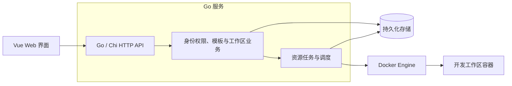

# 架构草案

## 当前实现

当前程序是使用 Chi 路由的单进程 HTTP 服务，已接入 PostgreSQL、版本化迁移、用户与会话持久化，完成首次管理员初始化和密码认证。完整 RBAC、Docker 资源管理和前端尚未实现。

```text
cmd/server/                  进程入口、配置、信号处理和优雅退出
cmd/migrate/                 独立迁移命令，支持 up / down / status
internal/httpapi/            Chi 路由、统一失败响应、Cookie、CSRF 与限流
internal/auth/               初始化、Argon2id 密码认证与会话业务
internal/testutil/           集成测试专用的独立数据库 schema
internal/database/           pgx 连接池、嵌入式 Goose 迁移与集成测试
  migrations/                表结构迁移 SQL
  queries/                   用户、角色、初始化与会话 SQL
  dbgen/                     sqlc 生成的模型与查询方法
compose.yaml                 本地 PostgreSQL 服务及持久化卷
sqlc.yaml                    SQL 到 Go 的生成配置
scripts/build-release.sh     交叉编译、打包和 SHA-256 校验和
.github/scripts/             PR 标题校验
.github/workflows/           CI、PR 标题检查、标签发布
docs/                       项目指南、架构与决策记录
```

阅读代码时先看 `internal/httpapi/router.go` 及测试，再看 `cmd/server/main.go`。

追踪认证时，按 `httpapi/auth.go` → `auth/service.go` → `database/queries/auth.sql` 阅读：HTTP 层解析凭据并处理 Cookie，业务层组织事务，SQL 检查会话过期和用户状态。账号停用时的会话撤销位于 `migrations/00002_auth.sql` 的 `users_revoke_sessions` 触发器，与登录时的用户行锁共同保证并发行为；对应测试在 `auth/auth_integration_test.go`。

数据层从 `migrations/00001_create_users.sql` 和 `queries/users.sql` 开始阅读。`database.Open` 创建连接池并验证连接；`dbgen.New(pool)` 提供用户创建和查询，`WithTx` 支持事务。`cmd/migrate` 通过 Goose 执行嵌入的迁移，HTTP 服务不自动修改表结构。`/healthz` 与 `/api/v1/auth` 都使用 Chi。HTTP 层通过小接口调用 `auth.Service`，统一映射业务错误；业务层使用 sqlc 和 pgx 事务，密码哈希与会话令牌不进入用户响应。用户基础规则见 [ADR-0007](adr/0007-postgresql-user-persistence.md)，认证模型、并发规则及错误格式见 [ADR-0008](adr/0008-authentication-and-http-errors.md)，接口见 [认证 API](auth-api.md)。

## 参考与简化

Coder 的 `coderd` 负责控制平面和 API，`provisionerd` 执行基础设施操作，工作区中的 agent 提供连接能力。该职责划分可作为学习参照，详见 [Coder 架构文档](https://coder.com/docs/install/plan/architecture)。

本项目拟从 Go 模块化单体起步，在同一服务中组织业务与后台任务，先用 Docker API 完成资源生命周期。架构方向及替代方案见 [ADR-0002（提议）](adr/0002-initial-architecture-direction.md)。下图是目标方向；目前已实现 HTTP、用户持久化和认证闭环：



## 目标职责

| 职责 | 内容与边界 |
| --- | --- |
| HTTP API | 解析请求、取得用户身份、调用业务、映射响应与错误 |
| 身份与授权 | Session + Cookie 识别身份；RBAC 决定角色权限，结合资源归属实施访问控制 |
| 模板与工作区 | 模板参数、工作区生命周期、期望状态与操作记录 |
| 任务与调度 | 执行创建、启停、删除任务，管理并发、额度、状态与日志 |
| Docker 接入 | 将资源操作映射为容器、网络和卷操作，返回执行结果 |
| 工作区访问 | 首阶段提供 xterm.js 实时终端，后续集成浏览器 IDE；在连接入口执行资源授权 |
| 持久化 | 保存用户、权限关系、模板、工作区和任务；管理迁移与事务 |
| Vue 界面 | 消费 HTTP API，组织页面与交互状态；权限展示依据服务端结果 |

随功能在 `internal/` 按业务职责增加包，HTTP 细节、业务规则和外部资源调用各有归属。需要替换实现或隔离外部依赖时再定义小接口；初期无需拆分微服务或引入通用调度框架。

## 技术方向与待决事项

已确定 HTTP 路由采用 [Chi](adr/0003-http-routing-with-chi.md)，浏览器认证采用 [服务端 Session + Cookie](adr/0004-server-side-browser-sessions.md)，资源授权采用 [RBAC 与资源归属约束](adr/0005-rbac-resource-authorization.md)。工作区访问按 [先 xterm.js 终端、后 IDE 集成](adr/0006-terminal-before-ide.md) 推进。Chi 与浏览器认证已实现；完整 RBAC 和工作区访问待实现。

Go 为现有后端语言；前端优先 Vue + TypeScript，构建工具优先考虑 Vite；Docker Engine 是首个资源后端。持久化已采用 [PostgreSQL + pgx + sqlc + Goose](adr/0007-postgresql-user-persistence.md)。RBAC 实现库和前端具体依赖随功能实现确定，版本规则见 [本地开发](development.md)。

Session 管理登录身份和有效期，RBAC 根据角色判断动作权限，再按资源归属约束作用范围。授权规则集中在业务层，列表查询同样按可访问范围过滤。额度、并发限制和资源放置由资源管理与调度模块负责；终端握手及后续 IDE 访问复用资源授权规则，详见 [工作区访问设计](workspace-access.md)。

数据模型、API 契约、权限矩阵和工作区状态机随功能实现补充。工作区运行状态与单次操作结果分别建模，重复操作、进程重启后的状态恢复、停止与删除时的数据卷语义在生命周期设计中明确。

## Coder 源码阅读入口

| 本项目学习内容 | 上游入口 |
| --- | --- |
| 控制平面与 API | [coderd/](https://github.com/coder/coder/tree/main/coderd) |
| 资源任务执行 | [provisionerd/](https://github.com/coder/coder/tree/main/provisionerd)、[provisioner/](https://github.com/coder/coder/tree/main/provisioner) |
| 工作区连接 | [agent/](https://github.com/coder/coder/tree/main/agent) |
| Web 页面与交互 | [site/](https://github.com/coder/coder/tree/main/site) |

这些链接指向上游默认分支，内容会演进。具体实现借鉴上游时，在相应设计或 PR 中记录实际参考的提交和路径。
