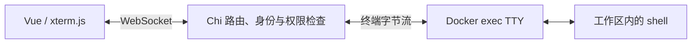

# 工作区访问设计

已确定先实现 xterm.js 实时终端，后续再集成 VS Code 类浏览器 IDE；浏览器登录使用 Session + Cookie，资源访问采用 RBAC 并结合资源归属检查。各能力尚未实现，IDE 产品及连接协议细节仍待选型。

## 实时终端

首阶段采用 xterm.js，顺序见 [ADR-0006](adr/0006-terminal-before-ide.md)。具体接入建议为 Vue 中使用 `@xterm/xterm` 和 `@xterm/addon-fit`，Go 通过 `github.com/coder/websocket` 接收连接，再通过 Docker Go SDK 创建和连接启用 TTY 的 exec 进程。

xterm.js 负责终端显示与键盘输入，shell 和实际命令运行在工作区内。PTY 是让 shell 获得交互终端行为的伪终端，首版由 Docker 的 TTY 机制提供。窗口行列变化调用 exec resize；输入输出与窗口尺寸、退出状态等控制消息分别定义。参考 [xterm.js](https://xtermjs.org/docs/)、[coder/websocket](https://pkg.go.dev/github.com/coder/websocket) 和 [Docker SDK](https://pkg.go.dev/github.com/moby/moby/client)。

握手时通过 Session 识别用户，检查终端连接权限、工作区归属及 Origin，容器由服务端根据工作区记录解析。对输出流设置背压与有界缓冲，处理断连、工作区停止和服务退出；连接中断后的 shell 生命周期需要在首版实现中明确。相关机制见 [xterm.js 流量控制](https://xtermjs.org/docs/guides/flowcontrol/)。

首版重连可建立新终端；如需重连后保留原会话，再加入工作区内的终端会话管理器。未来支持虚拟机或多种运行环境时，可增加工作区 agent，在资源内部管理 PTY、文件和应用连接。

## 后续浏览器 IDE 集成

在独立终端闭环完成后，再推进浏览器 IDE。优先评估 [code-server](https://coder.com/docs/code-server)：每个工作区运行自己的实例，代码、工具链和 IDE 使用同一工作目录，项目文件保存在持久化卷中。编译、调试和语言服务运行在工作区内。具体产品和接入方案在该阶段确定。

mini_coder 负责工作区授权和应用入口，访问代理转发 HTTP 与 WebSocket。code-server 自带的终端使用其自身协议；平台独立的 xterm.js 终端可以作为轻量入口，也是 Go 实时连接开发的学习内容。

管理界面与 API 可以同源；工作区 IDE 和用户应用使用与管理界面隔离的 origin，并为不同工作区规划独立来源。应用访问入口签发短期、限定工作区的访问凭据，管理会话 Cookie 保持 host-only，代理不将管理会话凭据转发给工作区。code-server 的服务端入口只供授权代理访问，代理负责每次 HTTP 请求和 WebSocket 握手的身份校验。参考 [code-server 代理与外部认证](https://coder.com/docs/code-server/guide)。

另一条路线是在 Vue 内嵌 [Monaco Editor](https://github.com/microsoft/monaco-editor)，自己实现文件树、读写、保存、语言服务连接和运行调试入口。Monaco 是编辑器组件，完整 IDE 的其余能力需要组合实现；这条路线适合以后专门学习编辑器和 LSP。

## 浏览器会话

采用服务端持久化的 Session，浏览器通过 HttpOnly Cookie 携带随机、不透明的会话标识，见 [ADR-0004](adr/0004-server-side-browser-sessions.md)。服务端据此解析身份、检查到期时间并按当前权限授权；退出时撤销会话。Cookie 的 Secure、SameSite 与 HTTP 请求的 CSRF 保护一并设计。

JWT 是令牌格式，Cookie 是浏览器保存和携带凭据的机制，Session 是会话管理方式；JWT 也能放入 Cookie。选择服务端 Session 的主要原因是当前单体服务容易查询共享状态，且需要方便地实现注销、停用账号与权限变更。

只离线验证签名和到期时间的 JWT，在有效期内不会自动感知服务端权限变化；需要短有效期、撤销记录或状态检查等机制。后续跨服务独立验签或 agent 的短期访问凭据仍可评估 JWT，当前浏览器会话采用已确定的 Session 方案。参考 [JWT 规范](https://www.rfc-editor.org/rfc/rfc7519) 与 [JWT 实践说明](https://cheatsheetseries.owasp.org/cheatsheets/JSON_Web_Token_Cheat_Sheet.html)。

浏览器原生 WebSocket API 没有设置任意 Authorization 请求头的参数，符合 Cookie 策略的凭据会在握手中自动携带；Cookie 内存的是会话标识还是 JWT，都可以利用这一点。见 [WebSockets 标准](https://websockets.spec.whatwg.org/)。

撤销 Session 或 JWT 都不会自动关闭已经建立的连接。服务端需要关联用户、会话与连接，在会话过期、注销或授权撤销时主动终止相关终端和 IDE 长连接。相关要求见 [WebSocket 会话管理](https://cheatsheetseries.owasp.org/cheatsheets/WebSocket_Security_Cheat_Sheet.html)。

## 资源授权

采用 [ADR-0005](adr/0005-rbac-resource-authorization.md) 的 RBAC 模型，以用户、角色、资源和动作为基础。工作区的查看、启停、删除、日志读取和终端连接分别定义权限，并结合资源归属约束作用范围。角色关系由服务端维护，授权使用当前权限；会话标识本身不携带权限快照。

HTTP 资源操作和终端握手复用业务层授权。后续 IDE 入口使用相同的工作区访问范围，资源调度模块继续负责额度和执行限制。

## 验证重点

首阶段验证终端交互输入输出、Ctrl+C、窗口缩放、中文显示、大量输出时的背压，以及断连与退出清理。权限测试覆盖角色允许与拒绝、匿名访问、跨用户工作区访问、非法 Origin，以及会话或权限撤销后的现有连接。

后续 IDE 阶段验证文件保存、工作区重启后的数据保留、语言服务、编译运行、代理的 HTTP / WebSocket 转发和不同工作区之间的访问隔离。
